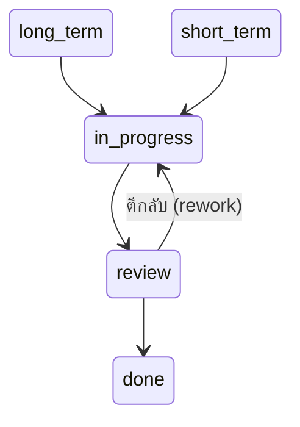

# Requirements: ระบบ Kanban Board บันทึกงาน

> เอกสารสเปกสำหรับการพัฒนา (source of truth) อ้างอิงรหัส FR-xx / BR-xx ในโค้ดและข้อความ commit
> ปรับปรุงล่าสุด: 22 พ.ย. 2026 (สังกัดงาน ตำแหน่ง login ด้วยการเลือกชื่อ แบบปีรายคน)

## 1. ภาพรวม

เว็บ Kanban Board ให้พนักงานแต่ละคนบันทึกงานของตัวเองใน 5 สถานะ และให้ Admin ดู/แก้งานของทุกคน พร้อมข้อมูลสำหรับวิเคราะห์ปริมาณงาน

- ผู้ใช้: ไม่เกิน 10 คน เริ่มใช้ที่งานวิชาการก่อน (มีสังกัดงานอื่นรองรับแล้ว ดู BR-29)
- Hosting: Vercel / Database + Auth: Supabase
- ภาษา UI: ไทย

### ขอบเขต

| อยู่ในขอบเขต | ไม่อยู่ในขอบเขต |
| --- | --- |
| Kanban 5 คอลัมน์ ลากย้ายงานได้ | แนบไฟล์ในงาน |
| ระบบผู้ใช้ username + password | คอมเมนต์ / แชทในงาน |
| Admin จัดการผู้ใช้ ดูและแก้บอร์ดทุกคน | แจ้งเตือนทางอีเมล / LINE |
| Dashboard สรุปปริมาณงาน | การ์ดที่หลายคนทำร่วมกัน |

### บทบาท

| บทบาท | สิทธิ์ |
| --- | --- |
| `user` | จัดการงานบนบอร์ดตัวเอง เปลี่ยนรหัสผ่านตัวเอง ดู Dashboard ของตัวเอง |
| `admin` | ทุกอย่างของ user + ดูและแก้บอร์ดทุกคน จัดการผู้ใช้ (รวมสร้าง admin, กำหนดสังกัดงานและตำแหน่ง) รีเซ็ตรหัส ปิดบัญชี จัดการหมวดหมู่ ตั้งเดือนเริ่มปีงบประมาณ ดู Dashboard รวม |

## 2. สถานะงาน (คอลัมน์)

| ลำดับ | `status` | ชื่อบนหน้าจอ | ความหมาย | กรอบเวลา |
| --- | --- | --- | --- | --- |
| 1 | `long_term` | งานระยะยาว (ภายในปี) | Project พัฒนาตนเอง / พัฒนาระบบงาน | ภายในปีที่ระบุ |
| 2 | `short_term` | งานค้างระยะสั้น | งานรอดำเนินการ | ควรเสร็จภายใน 30 วัน |
| 3 | `in_progress` | กำลังทำ | ลงมือทำอยู่ | - |
| 4 | `review` | รอตรวจสอบ | รอหัวหน้า/ผู้เกี่ยวข้องตรวจ | - |
| 5 | `done` | เสร็จแล้ว | ปิดงานแล้ว | - |

เส้นในแผนภาพคือเส้นทางปกติ ผู้ใช้ยังลากย้ายไปคอลัมน์ใดก็ได้ (BR-02)

### Business rules

- **BR-01** สร้างงานใหม่ได้ในทุกคอลัมน์ (รองรับการบันทึกย้อนหลัง) ปุ่ม "+ เพิ่มงาน" อยู่ท้ายทุกคอลัมน์
  - สร้างใน `in_progress`, `review`, `done` → ต้องกรอกวันเริ่มจริง (ค่าเริ่มต้น = วันนี้)
  - สร้างใน `done` → ต้องกรอกวันเสร็จจริงด้วย (ค่าเริ่มต้น = วันนี้)
- **BR-02** ลากย้ายได้ทุกคอลัมน์ และเรียงลำดับภายในคอลัมน์ได้
- **BR-03** ย้ายเข้า `in_progress` ครั้งแรก → ตั้ง `started_at` (ถ้ายังว่าง)
- **BR-04** ย้ายเข้า `done` → ตั้ง `completed_at` / ย้ายออกจาก `done` → ล้าง `completed_at`
- **BR-05** `review` → `in_progress` นับเป็น rework 1 ครั้ง
- **BR-06** ผู้ย้ายงานออกจาก `review` ได้: เจ้าของงาน และ admin
- **BR-07** งาน `short_term` ที่ `due_date` เกิน 30 วันนับจากวันสร้าง → แสดงคำแนะนำให้ย้ายไป `long_term` (ไม่บังคับ)
- **BR-08** `in_progress` มีเกิน 5 งาน → แสดงคำเตือน WIP (ไม่บล็อก)
- **BR-09** งานทุกชิ้นมี `year` บอร์ดแสดงงานของปีที่เลือก (ค่าเริ่มต้น = ปีปัจจุบัน)
- **BR-10** การนับปีตาม `profiles.year_type` ของเจ้าของบอร์ด (BR-31): `calendar` (ปี พ.ศ. ม.ค.–ธ.ค.) หรือ `fiscal` (ปีงบประมาณ เริ่มเดือน `app_settings.fiscal_start_month` ค่าเริ่มต้น ต.ค. เรียกตามปีที่สิ้นสุด) มีผลกับปีเริ่มต้นของบอร์ดและป้ายปี _(แก้ไข 22 พ.ย. 2026: เดิมเป็นค่าเดียวทั้งระบบ)_
- **BR-11** งาน `long_term` ที่ไม่เสร็จเมื่อสิ้นปี กด "ยกไปปีถัดไป" ได้ โดยเก็บปีต้นทางใน `carried_from_year`
- **BR-12** ลบงานแบบ soft delete (`is_deleted = true`)

## 3. ระบบผู้ใช้

- **BR-20** Login ด้วยการ**เลือกชื่อ-นามสกุลจากรายการ** (เฉพาะบัญชีที่ใช้งานอยู่ จัดกลุ่มตามสังกัดงาน) + password ไม่มีหน้าสมัครเอง บัญชีสร้างโดย admin เท่านั้น / ชื่อ-นามสกุลของบัญชีที่ใช้งานอยู่ห้ามซ้ำกัน _(แก้ไข 22 พ.ย. 2026: เดิมพิมพ์ username — หน้า login จึงเปิดเผยรายชื่อพนักงานที่ใช้งานอยู่ ผู้ใช้ยอมรับแล้ว)_
- **BR-21** username เป็นค่าภายใน ระบบสร้างให้อัตโนมัติ (`u_` + เลขสุ่ม) และแปลงเป็นอีเมลภายในก่อนเรียก Supabase Auth: `<username>@kanban.local` ผู้ใช้ไม่เห็นทั้ง username และอีเมลนี้
- **BR-22** username: `a-z 0-9 . _` ยาว 3–30 ตัว ไม่ซ้ำ (เก็บเป็นตัวพิมพ์เล็ก)
- **BR-23** รหัสผ่านเริ่มต้น `123456` (อ่านจาก env `DEFAULT_PASSWORD`) — Supabase Auth กำหนดขั้นต่ำ 6 ตัว
- **BR-24** บัญชีใหม่และบัญชีที่ถูกรีเซ็ต → `must_change_password = true` ใช้งานได้ตามปกติ แต่แสดงแถบเตือนให้เปลี่ยนรหัสผ่านทุกหน้า (ปิดไม่ได้) จนกว่าจะเปลี่ยน และห้ามใช้รหัสเริ่มต้นซ้ำ _(แก้ไข 20 พ.ย. 2026: เดิมบังคับเปลี่ยนก่อนใช้งาน)_
- **BR-25** ลืมรหัสผ่าน → แจ้ง admin กด "รีเซ็ตรหัสผ่าน" (กลับเป็นรหัสเริ่มต้น + BR-24)
- **BR-26** ปิดการใช้งานแทนการลบ (`is_active = false`) ผู้ใช้ที่ถูกปิดเข้าระบบและเรียกข้อมูลไม่ได้
- **BR-27** admin ลดสิทธิ์หรือปิดบัญชีตัวเองไม่ได้ และต้องมี admin ที่ใช้งานได้อย่างน้อย 1 คนเสมอ
- **BR-28** admin แก้งานในบอร์ดคนอื่นได้ ระบบบันทึก admin เป็น `changed_by` ใน `task_history` และ UI แสดงแถบบอกชัดว่ากำลังแก้บอร์ดของใคร
- **BR-29** ผู้ใช้ทุกคนมีสังกัดงาน 1 งาน จากรายการตายตัว: งานวิชาการ / งานบริหาร / งานแผนงาน / งานพัฒนาทักษะดิจิทัล (admin ไม่ต้องเพิ่มงาน — เปลี่ยนรายการผ่าน migration เท่านั้น) admin เพิ่มคนในแต่ละงานได้
- **BR-30** ตำแหน่ง (ข้อความอิสระ ≤ 100 ตัวอักษร) กรอกและแก้โดย admin เท่านั้น ผู้ใช้แก้ตำแหน่ง/สังกัด/บทบาทของตัวเองไม่ได้
- **BR-31** ผู้ใช้แก้ชื่อ-นามสกุลของตัวเอง และเลือกแสดงปีแบบ ปีงบประมาณ (ค่าเริ่มต้น) หรือ ปี พ.ศ. ได้ที่หน้าโปรไฟล์ ตัวเลขปีของงานที่บันทึกแล้วไม่เปลี่ยนตาม

### วันลา _(เพิ่ม 22 พ.ย. 2026)_

- **BR-40** ผู้ใช้แจ้งวันลาได้ทั้งลาวันเดียวและลาเป็นช่วงวันที่ ประเภท: ลาป่วย / ลากิจ / ลาพักผ่อน / ลาราชการ / ลาคลอด / อื่น ๆ พร้อมหมายเหตุสั้น ๆ (ไม่บังคับ ≤ 200 ตัวอักษร) แจ้งย้อนหลังหรือล่วงหน้าได้ ไม่มีขั้นตอนอนุมัติ ไม่มีลาครึ่งวัน
- **BR-41** นับเฉพาะวันทำการ จันทร์–ศุกร์ (ยังไม่ตัดวันหยุดนักขัตฤกษ์)
- **BR-42** วันลาของคนเดียวกันห้ามซ้อนกัน (ตรวจที่ database)
- **BR-43** ช่วงลาที่คร่อมเดือนนับแยกเข้าแต่ละเดือนตามวันจริง Dashboard ของ admin แสดงวันลารายเดือนของทุกคนตามปีที่เลือก
- **BR-44** ผู้ใช้จัดการวันลาของตัวเอง admin บันทึก/แก้/ยกเลิกแทนทุกคนได้ ยกเลิก = soft delete

### สำรองและกู้คืนข้อมูล _(เพิ่ม 22 พ.ย. 2026)_

- **BR-45** admin ดาวน์โหลด backup ทั้งระบบเป็นไฟล์ JSON ไฟล์เดียว: ผู้ใช้ (ไม่มีรหัสผ่าน), หมวดหมู่, งานทั้งหมดรวมที่ลบแล้ว, ประวัติการย้ายงาน, วันลารวมที่ยกเลิกแล้ว, การตั้งค่าปีงบประมาณ
- **BR-46** admin กู้คืนจากไฟล์: เพิ่มเฉพาะข้อมูลที่ยังไม่มี (id เดิม = ซ้ำ → ข้าม ไม่เขียนทับ / ประวัติการย้ายซ้ำเมื่อ งาน+จาก+ไป+เวลา+ผู้ย้าย ตรงกัน / หมวดหมู่ชื่อเดียวกันใช้หมวดเดิม) / ผู้ใช้ที่ไม่มีในระบบได้บัญชีใหม่ด้วยรหัสเริ่มต้น (BR-24) / การตั้งค่าไม่เขียนทับ แจ้งเมื่อค่าต่างกัน / รายงานผล เพิ่มใหม่-ข้าม-ไม่สำเร็จ แยกตามประเภท พร้อมเหตุผล

## 4. ข้อมูลการ์ดงาน

| ฟิลด์ | บังคับ | หมายเหตุ |
| --- | --- | --- |
| ชื่องาน `title` | ✓ | ไม่เกิน 200 ตัวอักษร |
| รายละเอียด `description` | - | ข้อความยาว |
| สถานะ `status` | ✓ | 1 ใน 5 สถานะ |
| หมวดหมู่ `category_id` | ✓ | จากรายการที่ admin กำหนด (เริ่มต้น: พัฒนาตนเอง / พัฒนาระบบงาน / งานประจำ / อื่น ๆ) |
| ความสำคัญ `priority` | ✓ | 1 สูง / 2 กลาง / 3 ต่ำ (ค่าเริ่มต้น 2) |
| ปี `year` | ✓ | ค่าเริ่มต้น = ปีปัจจุบันตาม BR-10 |
| วันกำหนดเสร็จ `due_date` | - | แนะนำให้กรอกสำหรับงานระยะสั้น |
| ความคืบหน้า `progress` | - | 0–100 ใช้กับงานระยะยาว |
| `started_at` / `completed_at` | อัตโนมัติ | แก้เองได้เมื่อบันทึกย้อนหลัง (BR-01) |

## 5. Functional requirements

| รหัส | ฟีเจอร์ | ระดับ | Phase |
| --- | --- | --- | --- |
| FR-01 | Login (เลือกชื่อจากรายการ + password) / Logout | Must | 1 |
| FR-02 | แจ้งเตือนให้เปลี่ยนรหัสผ่านเมื่อใช้รหัสเริ่มต้น | Must | 1 |
| FR-03 | ผู้ใช้เปลี่ยนรหัสผ่านตัวเอง | Must | 1 |
| FR-04 | Admin สร้างผู้ใช้ กำหนดชื่อ-นามสกุล สังกัดงาน ตำแหน่ง และ role | Must | 1 |
| FR-05 | Admin รีเซ็ตรหัสผ่านเป็นค่าเริ่มต้น | Must | 1 |
| FR-06 | Admin ปิด / เปิดการใช้งานผู้ใช้ | Must | 1 |
| FR-07 | สร้างงานได้ทุกสถานะ แก้ไข ลบ (soft delete) | Must | 1 |
| FR-08 | ลากย้ายงานระหว่างคอลัมน์ และเรียงลำดับในคอลัมน์ | Must | 1 |
| FR-09 | ปุ่ม "บันทึก" ส่งการเปลี่ยนแปลงทั้งหมดครั้งเดียว + ตัวนับรายการที่ยังไม่บันทึก | Must | 1 |
| FR-10 | เตือนเมื่อออกจากหน้า / เปลี่ยนปี / สลับบอร์ด โดยยังไม่บันทึก | Must | 1 |
| FR-11 | Admin เลือกผู้ใช้เพื่อดูและแก้บอร์ดของคนนั้น | Must | 1 |
| FR-12 | เลือกดูบอร์ดตามปี | Must | 1 |
| FR-18 | Admin จัดการหมวดหมู่ (เพิ่ม / แก้ชื่อ / เรียงลำดับ / ปิดใช้งาน) | Must | 1 |
| FR-19 | Admin ตั้งเดือนเริ่มปีงบประมาณ / ผู้ใช้เลือกแบบปีของตัวเอง (BR-31) | Must | 1 |
| FR-20 | เจ้าของงานและ admin ย้ายงานออกจาก "รอตรวจสอบ" ได้ | Must | 1 |
| FR-13 | ไฮไลต์งานเกินกำหนด (แดง) และใกล้ครบกำหนดภายใน 3 วัน (ส้ม) | Should | 2 |
| FR-14 | ค้นหาและกรองงานตามหมวดหมู่ / ความสำคัญ | Should | 2 |
| FR-16 | Dashboard วิเคราะห์ปริมาณงาน (หัวข้อ 6) | Should | 2 |
| FR-15 | ยกงานระยะยาวที่ไม่เสร็จไปปีถัดไป | Should | 3 |
| FR-17 | Export ข้อมูลงานเป็น CSV | Should | 3 |
| FR-21 | ระบบทีม/แผนก ให้หัวหน้าเห็นเฉพาะลูกทีม | Could | 3 |
| FR-22 | แจ้งวันลา (วันเดียว/ช่วง) และสรุปวันลารายเดือนใน Dashboard (BR-40..44) | Must | 2 |
| FR-23 | Admin สำรองและกู้คืนข้อมูลจากไฟล์ พร้อมรายงานผล (BR-45, 46) | Must | 2 |

### Acceptance criteria (Phase 1)

- **FR-01** รหัสผิด → ข้อความ "รหัสผ่านไม่ถูกต้อง" / บัญชีที่ปิดใช้งานไม่อยู่ในรายการให้เลือก
- **FR-02** login ด้วยบัญชีที่ `must_change_password = true` → ใช้งานได้ทุกหน้า และทุกหน้าแสดงแถบเตือน "คุณยังใช้รหัสผ่านเริ่มต้น" พร้อมปุ่มไปเปลี่ยนรหัสที่หน้าโปรไฟล์ แถบหายเมื่อเปลี่ยนสำเร็จ _(แก้ไข 20 พ.ย. 2026)_
- **FR-04** ผู้ใช้ใหม่ login ด้วย `123456` ได้ทันทีและเห็นแถบเตือนให้เปลี่ยนรหัส (FR-02)
- **FR-06** ผู้ใช้ที่ถูกปิดซึ่ง login ค้างอยู่ → คำขอถัดไปถูกปฏิเสธและถูกพาออกจากระบบ
- **FR-08** ลากวางได้ทั้งเมาส์และ touch บนมือถือ
- **FR-09** บันทึกสำเร็จทั้งหมดหรือไม่บันทึกเลย (transaction) ถ้ามีงานที่ถูกแก้จากที่อื่น → แจ้งรายการที่ชนและไม่เขียนทับ
- **FR-10** ปิดแท็บขณะมีรายการยังไม่บันทึก → เบราว์เซอร์เตือน เปิดกลับมา → ถามว่าจะกู้ร่างหรือไม่
- **FR-11** admin แก้งานคนอื่นแล้วบันทึก → `task_history.changed_by` = admin
- **RLS** user A อ่าน/แก้งานของ user B ไม่ได้ ทั้งผ่าน UI และเรียก Supabase ตรง

## 6. Dashboard (FR-16)

| ตัวชี้วัด | วิธีคำนวณ |
| --- | --- |
| จำนวนงานตามสถานะ รายคน | นับงาน (`is_deleted = false`) แยก `status` ต่อ `owner_id` |
| งานเกินกำหนด | `due_date < today` และ `status <> 'done'` |
| งานที่เสร็จต่อเดือน (throughput) | นับ `completed_at` ตามเดือน |
| Cycle time เฉลี่ย | `completed_at − started_at` |
| เวลารอตรวจสอบเฉลี่ย | ช่วงเวลาที่อยู่ใน `review` จาก `task_history` |
| อัตราตีกลับ | จำนวน `review → in_progress` ÷ จำนวนงานที่เคยเข้า `review` |
| ความคืบหน้างานระยะยาวของปี | งาน `long_term` ที่เสร็จ ÷ ทั้งหมดของปี และ `progress` เฉลี่ย |
| สัดส่วนตามหมวดหมู่ | นับงานที่เสร็จแยก `category_id` |

- การ์ดตัวเลข 4 ใบ: งานค้างทั้งหมด, เกินกำหนด, เสร็จเดือนนี้, cycle time เฉลี่ย
- กราฟแท่งงานเสร็จรายเดือน + ตารางสรุปรายคน
- user เห็นของตัวเอง / admin เห็นทุกคน กรองตามคนและช่วงเวลา
- คำนวณใน SQL view หรือ function ไม่ดึงทุกแถวมาคำนวณฝั่ง client
- ขอบเขตข้อมูล = งานที่ `tasks.year` = ปีที่เลือก (ตรงกับบอร์ด) กราฟรายเดือนนับตามเดือนของ `completed_at` แสดง 12 เดือนตามแบบปีของผู้ดู (BR-31) _(ตกลง 22 พ.ย. 2026)_
- FR-13: ใกล้ครบกำหนด = วันนี้ถึงอีก 3 วัน (รวมวันนี้) / FR-14: ตัวกรองไม่ถูกจำ ล้างเมื่อ refresh

## 7. สถาปัตยกรรมและเทคนิค

| ส่วน | เครื่องมือ |
| --- | --- |
| Framework | Next.js (App Router) + TypeScript |
| Drag & drop | dnd-kit |
| Client state | Zustand |
| UI | Tailwind CSS + shadcn/ui |
| Chart | Recharts |
| Supabase | @supabase/supabase-js + @supabase/ssr |

1. Browser โหลดแอปจาก Vercel
2. อ่าน/บันทึกงาน → Supabase ตรง คุมสิทธิ์ด้วย RLS
3. งาน admin (สร้างผู้ใช้, รีเซ็ตรหัส, เปลี่ยน role, ปิดบัญชี) → API route บน Vercel ที่ใช้ `SUPABASE_SERVICE_ROLE_KEY` ฝั่ง server เท่านั้น และตรวจว่าผู้เรียกเป็น admin ทุกครั้ง

### กลยุทธ์ "จัดการเสร็จแล้วค่อย Save"

1. เปิดบอร์ด: โหลดงานของปีที่เลือกเข้า Zustand store และเก็บ snapshot ต้นฉบับ
2. ระหว่างใช้งาน: สร้าง/แก้/ลาก/ลบ เปลี่ยนแค่ state ไม่เรียก database ทุกการย้ายคอลัมน์เก็บ `moved_at` (เวลาจริง)
3. กด "บันทึก": diff state กับ snapshot → ส่งครั้งเดียวไปที่ `save_board_changes(p_changes jsonb)`
4. `save_board_changes`: `security invoker` (ให้ RLS ทำงาน), transaction เดียว, ตรวจ `version` ทุกงานที่แก้ (ไม่ตรง → ยกเลิกทั้งหมดและคืนรายการที่ชน), ใช้ BR-03/BR-04, เขียน `task_history` ด้วย `moved_at`, `version + 1`
5. พักร่างใน localStorage กู้คืนได้เมื่อเปิดกลับมา

## 8. ฐานข้อมูล (Supabase / PostgreSQL)

ข้อมูล login อยู่ใน `auth.users` ของ Supabase

### profiles

| คอลัมน์ | ชนิด | หมายเหตุ |
| --- | --- | --- |
| id | uuid PK | = `auth.users.id` |
| username | text unique | ตัวพิมพ์เล็ก |
| display_name | text | |
| role | text | `user` \| `admin` |
| unit_id | text FK → units | สังกัดงาน (BR-29) |
| position | text | ตำแหน่ง ≤ 100 แก้โดย admin (BR-30) |
| year_type | text | `fiscal` (default) \| `calendar` เลือกเองที่โปรไฟล์ (BR-31) |
| must_change_password | boolean | default true |
| is_active | boolean | default true |
| created_at | timestamptz | |

### tasks

| คอลัมน์ | ชนิด | หมายเหตุ |
| --- | --- | --- |
| id | uuid PK | |
| owner_id | uuid FK → profiles | |
| title | text | ≤ 200 |
| description | text | |
| status | text | check 5 ค่า |
| category_id | uuid FK → categories | |
| priority | smallint | 1–3 |
| year | smallint | |
| due_date | date | |
| progress | smallint | 0–100 |
| position | numeric | ลำดับในคอลัมน์ |
| carried_from_year | smallint | |
| started_at / completed_at | timestamptz | |
| version | integer | default 1 |
| is_deleted | boolean | default false |
| created_at / updated_at | timestamptz | trigger อัปเดต `updated_at` |

### task_history

| คอลัมน์ | ชนิด | หมายเหตุ |
| --- | --- | --- |
| id | bigint PK identity | |
| task_id | uuid FK → tasks | |
| from_status | text | null เมื่อสร้างงานใหม่ |
| to_status | text | |
| changed_by | uuid FK → profiles | |
| changed_at | timestamptz | `moved_at` จาก client |

### categories

| คอลัมน์ | ชนิด | หมายเหตุ |
| --- | --- | --- |
| id | uuid PK | |
| name | text unique | |
| sort_order | smallint | |
| is_active | boolean | ปิดแทนการลบ |

### units (รายการตายตัว)

| คอลัมน์ | ชนิด | หมายเหตุ |
| --- | --- | --- |
| id | text PK | `academic`, `administration`, `planning`, `digital_skills` |
| name | text unique | ชื่อภาษาไทย |
| sort_order | smallint | |

### leaves

| คอลัมน์ | ชนิด | หมายเหตุ |
| --- | --- | --- |
| id | uuid PK | |
| owner_id | uuid FK → profiles | ผู้ลา |
| leave_type | text | `sick`, `personal`, `vacation`, `official`, `maternity`, `other` |
| start_date / end_date | date | end ≥ start |
| note | text | ≤ 200 |
| created_by | uuid FK → profiles | ผู้บันทึก (`auth.uid()`) |
| is_deleted | boolean | ยกเลิก = soft delete |
| created_at / updated_at | timestamptz | |

### app_settings (แถวเดียว)

| คอลัมน์ | ชนิด | หมายเหตุ |
| --- | --- | --- |
| fiscal_start_month | smallint | default 10 |
| updated_by | uuid FK → profiles | |

### RLS

1. user อ่าน/เขียน `tasks` เฉพาะแถวที่ `owner_id = auth.uid()`
2. admin อ่านและแก้ `tasks`, `task_history` ได้ทุกแถว
3. user อ่าน `profiles` ของตัวเอง แก้ `role` / `is_active` ไม่ได้ / admin อ่านได้ทุกแถว การแก้ role / is_active ผ่าน API route ของ admin เท่านั้น
4. ทุกคนอ่าน `categories`, `app_settings`, `units` ได้ / แก้ `categories`, `app_settings` ได้เฉพาะ admin / `units` แก้ผ่าน migration เท่านั้น
7. ผู้ใช้ไม่มีสิทธิ์ UPDATE `profiles` — แก้ชื่อและ `year_type` ของตัวเองผ่าน server action (service role, เฉพาะ 2 ฟิลด์นี้)
5. ผู้ใช้ `is_active = false` ถูกปฏิเสธทุกคำขอ
6. ใช้ฟังก์ชัน `is_admin()` ใน policy

อนาคต (FR-21): ใช้ `units` / `profiles.unit_id` ที่มีแล้วเป็นฐาน ให้หัวหน้าเห็นเฉพาะคนในสังกัด

## 9. Non-functional

| ด้าน | ข้อกำหนด |
| --- | --- |
| การแสดงผล | คอมพิวเตอร์และมือถือ (มือถือแสดงทีละคอลัมน์ เลื่อนซ้าย-ขวา) |
| ภาษา | UI ภาษาไทย วันที่แบบไทย |
| ความเร็ว | เปิดบอร์ด 200 งานภายใน 2 วินาที ลากวางไม่หน่วง |
| ขนาด | ≤ 10 ผู้ใช้ ใช้แพ็กเกจฟรีได้ (โปรเจกต์ Supabase ฟรีอาจถูกหยุดชั่วคราวเมื่อไม่มีการใช้งานราว 1 สัปดาห์ ตรวจเงื่อนไขล่าสุด) |
| ความปลอดภัย | รหัสผ่าน hash โดย Supabase, RLS ทุกตาราง, service role key อยู่ใน env ของ Vercel เท่านั้น, HTTPS |
| สำรองข้อมูล | ตรวจนโยบาย backup ของแพ็กเกจ และ export CSV เป็นระยะ |

## 10. Milestones

| Milestone | เนื้อหา | FR |
| --- | --- | --- |
| M1 | ตั้งโปรเจกต์ เชื่อม Supabase deploy Vercel | - |
| M2 | Migration ทุกตาราง + RLS + seed + admin คนแรก | - |
| M3 | Login, บังคับเปลี่ยนรหัส, เปลี่ยนรหัสเอง | FR-01–03 |
| M4 | จัดการผู้ใช้ (admin) | FR-04–06 |
| M5 | บอร์ด 5 คอลัมน์ ลากวาง (state เท่านั้น) | FR-07, 08, 12 |
| M6 | บันทึก + history + กันข้อมูลชน + เตือน | FR-09, 10 |
| M7 | ส่วน admin: บอร์ดคนอื่น หมวดหมู่ ตั้งค่าปี | FR-11, 18–20 |
| M8 | Phase 2: ไฮไลต์ ค้นหา Dashboard | FR-13, 14, 16 |
